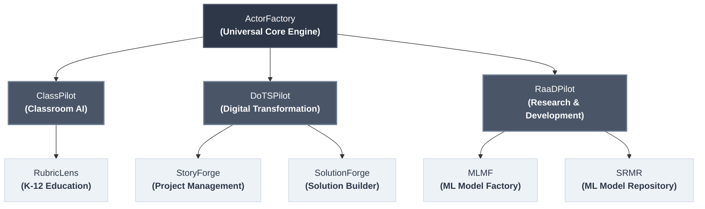

# ActorFactory 🤖🏭

ActorFactory is a universal, domain-agnostic infrastructure layer designed to build, catalog, and orchestrate specialized **Actor Armies** built from atomized capability sets.

Traditional enterprise software struggles to extract deterministic, reliable outputs from stochastic Large Language Models (LLMs). ActorFactory solves this by shifting away from general-purpose prompts and instead manufacturing dynamic composable profiles (**Personas × Specializations × Skills**) optimized for lightweight Small Language Models (SLMs) and cloud LLMs alike.

---

## 🚀 The Multi-Application Topology

ActorFactory is not a single application; it is the universal intelligence engine that sits underneath specific use cases. Downstream applications consume ActorFactory via a decoupled, LLM-blind backend API:



---

## 🛠️ Management Workspace Features

ActorFactory includes a modern, glassmorphic Next.js workspace for managing, configuring, and testing actor compositions:

- 🟢 **Live Stack Health Status**: Persistent sidebar badges (`🟢 API Connected`, `🟢 LLM: gemma3:12b`) polling system health and latency.
- 🌱 **Seed Engine & Factory Reset**: One-click catalog reset (`🌱 Seed Library`) and idempotent auto-seeding.
- 📋 **Prompt Engineering Audit**: Daily rotating JSONL log files (`output/llm_audit_logs/`) with daily gzip archiving (`.jsonl.gz`), on-demand date range searching, git commit SHA tracking, and per-type logging controls.
- ⚙️ **LLM Configurations**: Manage LLM providers (Ollama Local, Ollama Remote, OpenAI, Anthropic, AWS Bedrock, Mock), base URLs, API keys, test connection latency, and discover available models.
- 🌐 **Domains**: Define problem domain operational contexts (e.g. `K-12 Education`, `Software Engineering`, `InfoSec`) and default JSON parameter schemas.
- 🎭 **Actors (Personas)**: Define expert identities (e.g. `Teaching Assistant`, `Software Architect`, `Security Architect`), core concerns, domain vocabulary, thinking patterns, and quality criteria.
- ⚡ **Skills**: Define cross-cutting executable capabilities (e.g. `Rubric-Based Assessment & Grading`, `Mermaid Architecture Diagram`, `User Story Writing`) with output formats, validation levels (`machine`, `structural`, `heuristic`), validation rules, quality patterns, and anti-patterns.
- 🔧 **Specializations**: Define platform/subject expertise (e.g. `STEM & Quantitative Assessments`, `Humanities & Subjective Writing`, `AWS`), constraints, usage examples, and auto-detection keywords.
- 🔗 **Composer**: 3-step matrix selector (`Persona × Specialization × Skill`) with real-time prompt compilation preview and profile persistence.
- 🧪 **Test Bench**: Interactive execution canvas for streaming model outputs with custom LLM Goal tags (e.g. `design_ecommerce_solution`, `evaluate_student_rubric`).

---

## ⚡ Developer Quickstart & Makefile Commands

ActorFactory includes defensive, idempotent `make` dev lifecycle targets:

```bash
# 1. First-time setup (installs Python packages via uv sync + frontend npm packages)
make setup

# 2. Start development environment (FastAPI on :8082, Next.js on :3002)
make dev-up

# 3. Check health status of all local services
make dev-status

# 4. Restart development servers cleanly
make dev-restart

# 5. Stop background development servers
make dev-down

# 6. Run pytest automated test suite
make test
```

### All Makefile Targets Reference

| Target | Description |
|--------|-------------|
| `make help` | Show available targets |
| `make setup` | Set up Python `.venv` with `uv sync` and install frontend `npm` dependencies |
| `make dev-up` | Start FastAPI & Next.js background servers (idempotent, checks ports & setup prereqs) |
| `make dev-down` | Stop background servers cleanly (no-ops if servers aren't running) |
| `make dev-restart` | Restart development servers cleanly |
| `make dev-status` | Health check all services (`:8082/health`, `:3002`, Ollama `:11434`) |
| `make test` | Run tests with `pytest` |
| `make build-docker` | Build local Docker container image |
| `make run-docker` | Run Docker container locally |
| `make clean` | Clean virtual environment and `__pycache__` artifacts |

---

## 📚 Documentation Index

All core designs, specification catalogs, and research documents are maintained under the `docs/` folder, organized into four areas:

**🏛️ [Architecture](./docs/architecture/README.md)** — internal engineering docs (not published to Confluence):

- 📐 **[System Architecture Overview](./docs/architecture/overview.md)** — Core topology, 3D composition matrix, data models, validation spectrum, LLM configurations, prompt audit log engine, and API routes.
- 🌱 **[Seed Engine & Factory Reset Pattern](./docs/architecture/seed-engine.md)** — Architectural design and implementation guide for idempotent seeding and database resets.
- 📚 **[Built-in Seed Catalog](./docs/architecture/seeds.md)** — Complete reference inventory of all default Problem Domains, Actor Personas, Skills, Specializations, Team Compositions, and LLM Providers.
- 🗄️ **[Storage Layer](./docs/architecture/storage-layer.md)** — Persistence design.
- 📐 **[AI Engineering](./docs/architecture/ai-engineering/)**:
  - 🗺️ **[AI Strategy & Blueprint](./docs/architecture/ai-engineering/ai-strategy.md)** — Multi-tiered AI application architecture blueprint.
  - 🧩 **[Persona × Skill Composition](./docs/architecture/ai-engineering/persona-skill-composition.md)** — Building validatable AI expertise & feedback chains.
  - 📊 **[Matrix Composition Summary](./docs/architecture/ai-engineering/persona-skill-specialization-summary.md)** — Personas, Skills, Specializations matrix summary.
  - 🎯 **[Goals & Samples](./docs/architecture/ai-engineering/goals-and-samples.md)** — First-class Goals and Samples scoped to domain actors.
  - 📖 **[Prompt Template Definitions](./docs/architecture/ai-engineering/prompt-template-definitions.md)** — Complete specification catalog of default templates.
  - 📝 **[Prompt Composition Reference](./docs/architecture/ai-engineering/prompt-composition-reference.md)** — Prompt preamble construction & formatting guide.
  - ⚡ **[Specialized Small Models](./docs/architecture/ai-engineering/specialized-small-models.md)** — SLM optimization, QLoRA fine-tuning, and model routing.

  - 🧭 **[Consumption Strategy](./docs/architecture/consumption-strategy.md)** — how apps consume ActorFactory: runtime composition vs. published versioned actor definitions + a shared compile library.
  - 🎭 **[UML Prompt Model](./docs/architecture/uml-prompt-model.md)** — a prompt as an identity; Domain / Actor / Goal / Specialization × Skill mapped to UML.

**❓ In-App Help** — user-facing Help & Documentation lives under `docs/help/` and is served inside the app by the docs API (not duplicated here).
