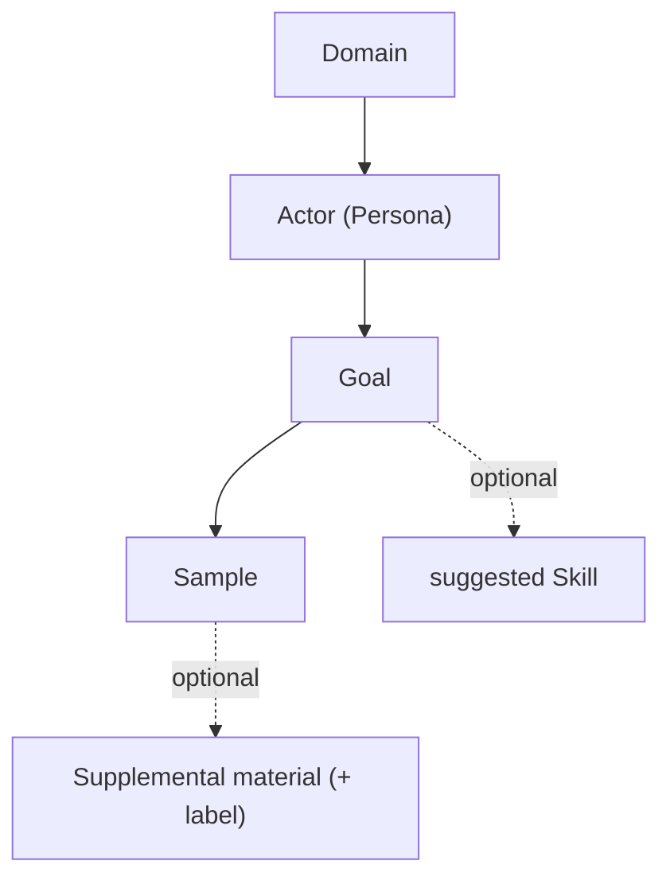

# Goals & Samples — the task dimension

**Added:** October 2026

Composition (Persona × Specialization × Skill) defines *who the model is, with what expertise, producing what form*. **Goals** add the missing dimension: *what task is the actor actually being asked to do* — and they are the unit by which runs are tracked and prompts are tuned.

---

## Why Goals exist

Before Goals, the "task" was a free-text `call_type` string used only as an audit label, and sample inputs were scattered, loosely keyed by domain. That made the Test Bench slanted toward whatever defaults were hard-coded (student grading, systems engineering) and gave no structured way to track or tune per task.

A Goal fixes this by being a **first-class, defined task** scoped to the actors that perform it.

---

## The model

### Goal
| Field | Meaning |
|-------|---------|
| `key` | Stable identifier; **becomes the audit-log `call_type`** (the tracking/tuning unit). e.g. `build_mermaid_diagram`. |
| `name` | Human label ("Build a Mermaid Diagram"). |
| `description` | What the actor is asked to do. |
| `domain_id` | The domain the goal belongs to. |
| `actor_ids` | Actor(s) the goal is designed for (empty = any actor in the domain). |
| `suggested_skill_id` | Optional default output skill. |
| `samples` | The goal's example inputs. |

### Sample
| Field | Meaning |
|-------|---------|
| `label` | Dropdown label. |
| `input` | The raw task payload. |
| `supplemental` | Optional generic reference material (rubric, coding standard, spec). |
| `supplemental_label` | What the reference is ("Grading Rubric", "Coding Standard", …) — drives the generic supplemental panel label. |

Key relationship: **a Sample belongs to a Goal.** Many samples share one goal key. The sample varies; the logged goal stays constant — so all runs of a goal form a comparable group.

---

## Tracking & tuning

Because `call_type` = the goal `key`, the audit log groups every run by goal:

- Filter the Audit Log by a goal key to see all runs of that task.
- Compare outputs across models or prompt edits for the *same* goal.
- Tune a skill/persona for one goal (e.g. tighten Mermaid rules for `build_mermaid_diagram`) without affecting unrelated goals.
- Over time each goal key accumulates an (input → output) dataset usable for evaluation or fine-tuning.

---

## Seeded catalog (2 goals per domain, 3 samples each)

| Domain → Actor | Goals (`key`) |
|----------------|----------------|
| Software Engineering → Software Architect | `build_mermaid_diagram`, `api_design` |
| Infrastructure & Ops → SRE | `design_infrastructure`, `write_runbook` |
| Product & Business Analyst → Product Owner | `generate_stories`, `process_analysis` |
| InfoSec & Security → Security Architect | `threat_modeling`, `security_review` |
| K-12 Education → Teaching Assistant | `evaluate_student_rubric`, `learning_gap_analysis` |
| Enterprise Architecture → Enterprise Architect | `integration_design`, `technology_roadmap` |

`build_mermaid_diagram` is shared across the Software Architect, SRE, and Enterprise Architect (the actors who legitimately draw diagrams).

---

## API

| Call | Purpose |
|------|---------|
| `GET /api/v1/goals` | All goals. |
| `GET /api/v1/goals?domain_id=&actor_id=` | Goals scoped to a domain and/or an actor they're designed for. |
| `GET /api/v1/goals/{id}` | One goal (with samples). |
| `POST /api/v1/goals` | Create/update a goal. |
| `DELETE /api/v1/goals/{id}` | Remove a goal. |

Scoping rule: a goal with no `actor_ids` matches any actor in its domain; otherwise the actor must be in `actor_ids`.

---

## Test Bench flow

1. Pick a Domain → Actor; the matching Goals populate the **Goal** selector.
2. Select a Goal → its `key` becomes the `call_type`; its Samples fill the **Load sample input** dropdown.
3. Select a Sample → fills the input and any generic supplemental material (panel relabels from `supplemental_label`).
4. Run → output streams back, audit-logged under the goal key.

An "advanced / custom" toggle still allows a free-text goal key for ad-hoc runs.

---

## File locations

| Component | Path |
|-----------|------|
| `Goal` / `Sample` models | `src/actor_factory/models/core.py` |
| Storage (goals table + CRUD) | `src/actor_factory/storage/sqlite.py` |
| Seeded goals | `src/actor_factory/storage/seed.py` (`_seed_goals`) |
| API | `src/actor_factory/api/routes.py` (goal endpoints) |
| Test Bench wiring | `frontend/src/app/components/TestBench.tsx` |

---

## Future

- A Goals management UI (CRUD screen) — today goals are seeded + API-managed.
- Supplemental-material storage/reuse (where uploaded references live and how they're shared across goals) — deliberately deferred.
- Per-goal evaluation dashboards built on the audit log.
