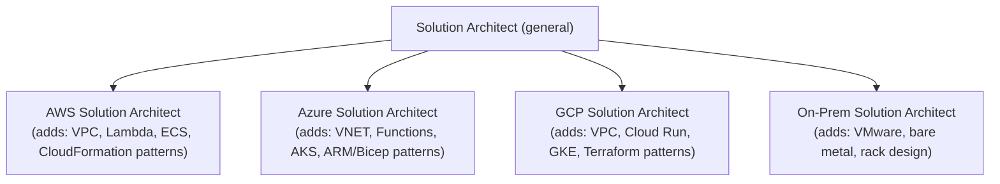
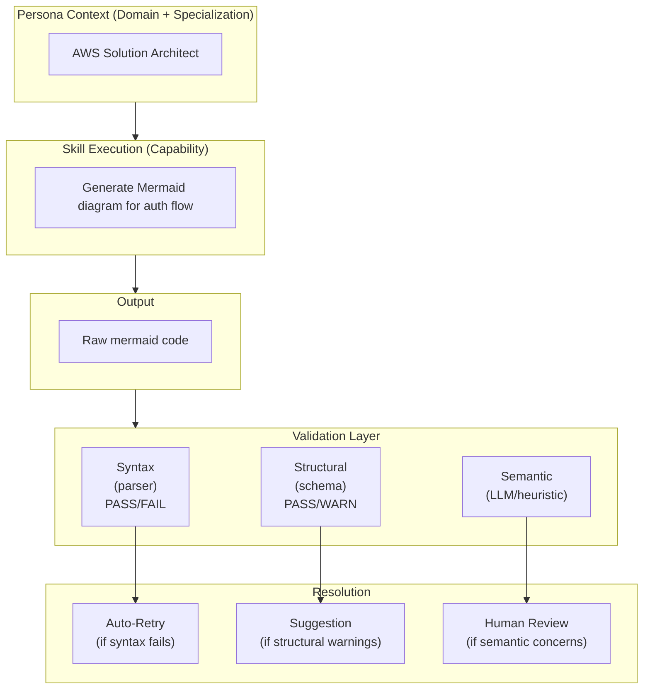
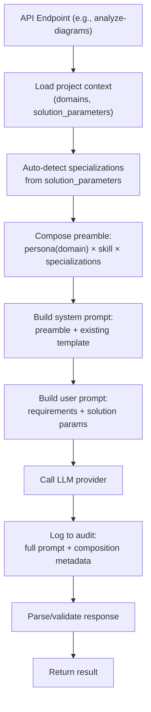

# Persona × Skill Composition: Building Validatable AI Expertise

> Heritage note: the composition insight below originated in StoryForge AI and is
> app-agnostic. ActorFactory applies the same model, with two differences: (1)
> building blocks are first-class SQLite entities seeded via the Seed Library
> (not YAML templates), and (2) a **Goal** dimension names the task an actor
> performs and carries **Samples** — see "Goals & Samples" at the end and the
> dedicated `goals-and-samples.md` reference.

## The Insight

Mermaid diagram building isn't a domain — it's a **skill** that can be attached to any domain persona. A Solution Architect draws different mermaid diagrams than an SRE, but both use the same syntax. The syntax is validatable (parseable or not). The architectural thinking behind the diagram is what varies by domain.

This reveals a composable structure:

```
Persona (domain expertise) × Skill (executable capability) = Specialized Agent
```

An "AWS Solution Architect who builds Mermaid diagrams" is:
- **Persona:** Solution Architect + AWS specialization
- **Skill:** Mermaid diagram construction
- **Output validator:** Mermaid parser (binary: renders or doesn't)

A "Business Analyst who writes user stories" is:
- **Persona:** Business Analyst + Agile methodology
- **Skill:** User story composition
- **Output validator:** ??? (this is where it gets interesting)

---

## The Composable Model

### Domains → Personas

Each domain represents a professional archetype with generalized knowledge:

| Domain | Persona | Generalized Knowledge |
|--------|---------|----------------------|
| Software Engineering | Software Architect/Engineer | Design patterns, system decomposition, API design, SOLID principles |
| Infrastructure & Ops | SRE / Cloud Engineer | Networking, deployment, monitoring, resilience, capacity planning |
| Enterprise Architecture | Enterprise Architect | Integration patterns, governance, portfolio management, TOGAF |
| InfoSec | Security Architect | Threat modeling, access control, encryption, compliance frameworks |
| Data Engineering & BI | Data Engineer/Architect | Pipelines, warehousing, modeling, quality, lineage |
| ML & AI | ML/MLOps Engineer | Model lifecycle, feature engineering, serving, monitoring, drift |

### Specializations → Persona Variants

Each persona can be narrowed with platform/vendor/methodology skills:



This is the "As a [Role]..." pattern from user stories applied to AI prompting:
- "As a **Solution Architect**..." → general architectural reasoning
- "As an **AWS Solution Architect**..." → reasoning + AWS-specific patterns and services

### Skills → Executable Capabilities

Skills are cross-cutting capabilities any persona might need:

| Skill | What It Does | Validator |
|-------|-------------|-----------|
| Mermaid Diagram Building | Produces valid mermaid syntax | ✅ Mermaid parser (binary pass/fail) |
| User Story Writing | Produces stories in standard format | ⚠️ Structural (has title, description, AC) |
| Requirements Analysis | Decomposes needs into structured requirements | ⚠️ Structural + coverage heuristics |
| API Design | Produces OpenAPI specs | ✅ OpenAPI schema validator |
| Terraform/IaC | Produces infrastructure code | ✅ `terraform validate` / `terraform plan` |
| SQL Schema Design | Produces DDL statements | ✅ SQL parser / dry-run |
| Test Case Writing | Produces test scenarios | ⚠️ Structural (given/when/then format) |
| Architecture Decision Records | Produces ADRs | ⚠️ Template conformance |
| Threat Model | Produces STRIDE analysis | ⚠️ Completeness heuristics |

---

## The Validation Problem

### Category 1: Machine-Validatable Skills (Binary)

These have deterministic validators — the output either passes or fails:

- **Mermaid syntax** → mermaid.js parser
- **JSON/YAML structure** → schema validator
- **OpenAPI spec** → Swagger validator
- **SQL** → database parser
- **Terraform** → `terraform validate`
- **Code compilation** → compiler/type checker

For these skills, we can build a tight feedback loop:
1. Model generates output
2. Validator checks it
3. If invalid → feed error back to model → retry
4. If valid → deliver to user

This is why mermaid-fixer works so well. There's ONE correct answer syntactically.

### Category 2: Structurally-Validatable Skills (Partial)

These have a known format/template but the *content quality* is subjective:

- **User stories** → Must have: title, description, acceptance criteria, story points. But is the *content* good?
- **Requirements** → Must have: ID, priority, rationale. But are they *complete*?
- **ADRs** → Must have: context, decision, consequences. But is the *reasoning* sound?

**What we can validate:**
- Schema conformance (all required fields present)
- Structural quality (acceptance criteria are testable statements, not vague)
- Cross-reference integrity (stories trace back to requirements)
- Completeness heuristics (coverage of functional areas)

**What we can't machine-validate:**
- Is this the *right* requirement?
- Is this story scoped correctly?
- Does this ADR consider the right alternatives?

### Category 3: Judgment-Dependent Skills (Soft)

These produce outputs where quality is entirely contextual:

- Architectural diagrams (beyond syntax — is the *architecture* right?)
- Solution design (does it meet the real constraints?)
- Stakeholder communication

**What we can do:** Provide rubrics, checklists, and comparative scoring. Use a larger model as a "reviewer" of the smaller model's output.

---

## Building Validators for Category 2

The key insight: **we can't validate correctness, but we can validate conformance, completeness, and internal consistency.**

### User Story Validator

```python
class StoryValidator:
    def validate(self, story: Story) -> ValidationResult:
        issues = []
        
        # Structural checks
        if not story.title: issues.append("Missing title")
        if not story.description: issues.append("Missing description")
        if len(story.acceptance_criteria) == 0: issues.append("No acceptance criteria")
        
        # Quality heuristics
        if not story.description.startswith("As a"):
            issues.append("Description doesn't follow 'As a...' pattern")
        
        for ac in story.acceptance_criteria:
            if not any(ac.lower().startswith(w) for w in ["given", "when", "then", "verify"]):
                issues.append(f"AC not in testable format: {ac[:50]}")
        
        # Size heuristics
        if story.points and story.points > 13:
            issues.append("Story may be too large (>13 points)")
        
        # Completeness
        if not story.epic_id:
            issues.append("Story not linked to an epic")
            
        return ValidationResult(valid=len(issues) == 0, issues=issues)
```

### Requirements Completeness Validator

```python
class RequirementsValidator:
    def validate(self, requirements: list[Requirement], domains: list[str]) -> ValidationResult:
        issues = []
        
        # Coverage: are all domains addressed?
        mentioned_domains = set()
        for req in requirements:
            for domain in domains:
                if domain_keywords_present(req.text, domain):
                    mentioned_domains.add(domain)
        
        missing = set(domains) - mentioned_domains
        if missing:
            issues.append(f"Domains not addressed: {missing}")
        
        # NFR coverage
        nfr_categories = ["performance", "security", "scalability", "availability"]
        mentioned_nfrs = [c for c in nfr_categories if any(c in r.text.lower() for r in requirements)]
        if len(mentioned_nfrs) < 2:
            issues.append("Limited non-functional requirement coverage")
        
        # Ambiguity detection
        vague_terms = ["should be fast", "user-friendly", "scalable", "secure"]
        for req in requirements:
            for term in vague_terms:
                if term in req.text.lower():
                    issues.append(f"Vague term '{term}' in requirement {req.id}")
        
        return ValidationResult(valid=len(issues) == 0, issues=issues)
```

### Diagram Architecture Validator (Beyond Syntax)

```python
class DiagramArchitectureValidator:
    def validate(self, diagram: Diagram, requirements: list[Requirement]) -> ValidationResult:
        issues = []
        
        # Syntax: machine-checkable
        parse_result = mermaid_parse(diagram.mermaid_code)
        if not parse_result.valid:
            issues.append(f"Syntax error: {parse_result.error}")
            return ValidationResult(valid=False, issues=issues)
        
        # Entity coverage: do key entities from requirements appear?
        entities = extract_entities(requirements)
        diagram_nodes = extract_node_labels(diagram.mermaid_code)
        missing = [e for e in entities if not fuzzy_match(e, diagram_nodes)]
        if missing:
            issues.append(f"Key entities not represented: {missing[:5]}")
        
        # Connectivity: are there orphan nodes?
        orphans = find_orphan_nodes(diagram.mermaid_code)
        if orphans:
            issues.append(f"Disconnected nodes: {orphans}")
        
        # Subgraph coherence: does grouping match domain boundaries?
        subgroups = extract_subgraphs(diagram.mermaid_code)
        if diagram.domain == "infrastructure_ops" and len(subgroups) == 0:
            issues.append("Infrastructure diagram should show network/service boundaries")
        
        return ValidationResult(valid=len(issues) == 0, issues=issues)
```

---

## The Feedback Loop Architecture



For **Category 1** skills (mermaid, terraform, SQL): the loop is fully automated. Retry until valid.

For **Category 2** skills (stories, requirements): flag issues, suggest fixes, but deliver to user for judgment.

For **Category 3** skills (architecture quality): provide scoring rubrics and comparative options, but the human decides.

---

## Practical Application: Composition in Practice

### Before
One generic prompt per operation:
- "Generate stories from these requirements"
- "Generate diagrams for these domains"

### After
Composed prompts: `Persona(domain, specialization) + Skill(capability) + Validator(feedback)`

```python
def build_prompt(domain: str, specialization: str, skill: str, context: dict) -> str:
    persona = load_persona(domain)          # "You are a Solution Architect..."
    skills = load_skills(specialization)     # "You specialize in AWS services..."
    capability = load_capability(skill)      # "Generate a mermaid sequence diagram..."
    constraints = load_validator_rules(skill) # "Must parse. Must reference these entities..."
    
    return compose(persona, skills, capability, constraints, context)
```

### What This Enables

1. **Smaller models work better** — narrow context, clear constraints, specific examples
2. **Outputs are validatable** — each skill knows its own validation chain
3. **Skills are reusable** — "mermaid diagram building" works for any persona
4. **Specializations stack** — "AWS" + "serverless" + "event-driven" → very focused
5. **Training data is derivable** — for each skill, generate (input, valid_output) pairs

---

## The Validation Spectrum Summary

| Skill | Can Validate | How | Auto-Retry? |
|-------|-------------|-----|-------------|
| Mermaid syntax | Correctness | Parser | ✅ Yes |
| OpenAPI spec | Correctness | Schema validator | ✅ Yes |
| SQL/DDL | Correctness | DB parser | ✅ Yes |
| Terraform | Correctness | `terraform validate` | ✅ Yes |
| User stories | Structure + heuristics | Template checker + rules | ⚠️ Partial |
| Requirements | Completeness + clarity | Coverage analysis + NLP | ⚠️ Partial |
| Diagrams (content) | Coverage + coherence | Entity matching + graph analysis | ⚠️ Partial |
| Architecture decisions | Reasoning quality | Rubric scoring / LLM review | ❌ Human |

---

## Next Steps

1. **Implement structural validators** for user stories and requirements (Category 2)
2. **Build the persona × skill composition engine** for prompt construction
3. **Create specialization packs** (AWS, Azure, GCP, on-prem) as loadable skill modules
4. **Derive training datasets** from validated outputs for Level 4 fine-tuning
5. **Establish the auto-retry loop** for Category 1 skills (mermaid-fixer is the prototype)
6. **Design rubric-based scoring** for Category 3 skills (architecture quality)

---

## Goals & Samples (ActorFactory addition)

Composition answers *who, with what expertise, in what form*. A **Goal** answers *what task* — and it is the unit of tracking and tuning.

- A **Goal** is a defined task an actor performs (e.g. `build_mermaid_diagram`, `evaluate_student_rubric`). Its `key` becomes the audit-log `call_type`, so every run for a goal is grouped: you can compare outputs and tune the prompt for one goal without touching another.
- A goal is scoped to a **domain** and the **actor(s)** it's designed for, so the Test Bench only offers goals that fit the current composition.
- Each goal owns **Samples** — interchangeable example inputs that all exercise the same goal. One goal, many samples (the e-commerce checkout, the notification service, the CI/CD pipeline all exercise `build_mermaid_diagram`).
- A sample can carry generic **supplemental reference material** (rubric, coding standard, reference spec) with a label — not hard-coded to grading.

This closes the loop on validatability: because a skill defines what "valid" looks like and a goal groups like tasks, the audit log becomes a per-goal dataset for evaluation and (eventually) fine-tuning.

See `goals-and-samples.md` for the data model and seeded catalog.

## The Key Takeaway

> The mermaid syntax fixer works because there's ONE correct answer that's machine-verifiable.
> The challenge for other skills isn't that we can't validate — it's that we need to define
> *what* valid looks like at each level: syntax, structure, completeness, and quality.
>
> The more precisely we define "valid" for each skill, the better small models perform,
> because they have a tighter target to hit.

Every validation rule we add is another constraint that narrows the solution space. A 12B model in a tight solution space outperforms a 70B model in an open one.

---

*Document authored: 2026-08-10*  
*Relates to: StoryForge AI prompt architecture, mermaid-fixer model, domain templates*


---

## Implementation Decisions (2026-08-10) — StoryForge heritage

> The decisions and file paths in the remainder of this document describe the
> original StoryForge AI implementation (YAML templates, `src/storyforge/...`).
> ActorFactory realizes the same ideas with SQLite entities and the Seed
> Library; see `persona-skill-specialization-summary.md` and
> `goals-and-samples.md` for ActorFactory's concrete structure.

### Decision 1: Specialization Detection — Auto-detect + Override + Suggestion

**Approach:** Parse solution parameters text (tech stack, platform capabilities, architectural patterns) for platform/vendor keywords. Return detected specializations with confidence. Surface in UI for user confirmation or override.

**Rationale:** Users shouldn't have to manually tag their project with "AWS" when they've already typed "Lambda, DynamoDB, S3" in solution parameters. But auto-detection can be wrong (mentioning AWS as a comparison point doesn't mean the project uses AWS), so the user gets the final say.

**Implementation:**
```python
detected = detect_specializations(solution_params_text)
# Returns: [("aws", 0.9), ("serverless", 0.7)]
# UI shows: "Detected: AWS, Serverless — Confirm or change?"
# For now: use detected without UI confirmation (backend only)
# Future: surface in UI for override
```

### Decision 2: Persona Scope — Per-Entry (not blended)

**Approach:** Each plan entry uses the persona matching its `domain` field. When multiple domains are selected for analysis, the LLM sees all domain personas in the system prompt context, but each generated diagram is attributed to one domain.

**Rationale:** Blending personas creates diluted context. A security diagram should think like a security architect, not a 50/50 blend of security + infra. The analysis step (Pass 1) sees all domains to make cross-cutting recommendations, but generation (Pass 2) narrows to the specific domain.

### Decision 3: Prompt Structure — General → Specific (Preamble + Template)

**Approach:** The composed persona/skill preamble is prepended before the existing system prompt. Existing prompt templates (domain-specific diagram type instructions, JSON output schema) remain unchanged.

**Structure:**
```
SYSTEM PROMPT = 
    [Persona × Skill preamble]     ← Composed from matrix
    [Existing system prompt body]  ← Template + output format rules
```

**Rationale:** The preamble sets the "who you are and how you think" context. The existing template provides the "what to do right now" instructions. General context first, specific task instructions second. This is additive — the existing prompts continue working as before, just with richer context.

### Decision 4: Replace (not toggle) + Full Tracing

**Approach:** Replace ad-hoc prompts with composed prompts. No toggle between old/new. But every call is fully traced in the audit log with composition metadata so results can be compared across:
- Different persona configurations
- Different specialization combinations
- Different LLM/SLM models
- Code versions (git SHA already captured)

**Audit log additions to `prompt_modifiers`:**
```json
{
  "persona": "software_engineering",
  "persona_title": "Software Architect / Engineer",
  "specializations": ["aws", "serverless"],
  "specialization_source": "auto-detected",
  "skill": "mermaid_diagram",
  "preamble_token_estimate": 450
}
```

**Rationale:** The old prompts are strictly less informative than the composed versions. There's no scenario where removing persona context helps. But the full trace means we can always go back and analyze what a prompt looked like at any point, compare results, and iterate.

### Decision 5: Integration Points (Phased)

| Phase | Target | Prompt Builder | Skill |
|-------|--------|---------------|-------|
| 1 | Diagram Analysis (Pass 1) | `_build_analysis_system_prompt()` | `mermaid_diagram` (analysis mode) |
| 2 | Diagram Generation (Pass 2) | Per-entry system prompt | `mermaid_diagram` (generation mode) |
| 3 | Diagram Fix | `fix_diagram_syntax()` | Route to `mermaid-fixer` model |
| 4 | Story Generation | Story builder prompts | `story_writing` |

Each phase is independently deployable and testable.

### Architecture: Integration Flow



### File Layout

```
src/storyforge/prompts/
├── __init__.py                    # Public API
├── persona_skill_matrix.py        # Personas, Skills, Specializations data
├── specialization_detector.py     # Auto-detect platforms from text (NEW)
└── composer.py                    # Integration helper for prompt builders (NEW)
```

---

*Decisions documented: 2026-08-10*
*Implementation branch: feature/prompt-composition-integration*


---

## Implementation Complete (2026-08-10)

### What Was Built

#### 1. YAML-Driven Template System

All prompt engineering data is now stored as admin-editable YAML files:

```
src/storyforge/templates/prompt_engineering/
├── personas/          ← 6 domain personas
│   ├── software_engineering.yaml
│   ├── infrastructure_ops.yaml
│   ├── enterprise_architecture.yaml
│   ├── infosec.yaml
│   ├── data_engineering_bi.yaml
│   └── machine_learning_ai.yaml
├── specializations/   ← 6 platform specializations (with detection keywords)
│   ├── aws.yaml
│   ├── azure.yaml
│   ├── gcp.yaml
│   ├── serverless.yaml
│   ├── kubernetes.yaml
│   └── agile_scrum.yaml
└── skills/            ← 5 cross-cutting capabilities
    ├── mermaid_diagram.yaml
    ├── story_writing.yaml
    ├── requirements_analysis.yaml
    ├── api_design.yaml
    └── threat_modeling.yaml
```

**Adding a new persona/skill/specialization** requires only creating a new YAML file in the appropriate directory and calling the reload endpoint. No code changes, no deployments.

#### 2. Admin CRUD API

```
GET    /api/v1/admin/prompt-templates/personas
GET    /api/v1/admin/prompt-templates/personas/{id}
PUT    /api/v1/admin/prompt-templates/personas/{id}
DELETE /api/v1/admin/prompt-templates/personas/{id}

GET    /api/v1/admin/prompt-templates/specializations
GET    /api/v1/admin/prompt-templates/specializations/{id}
PUT    /api/v1/admin/prompt-templates/specializations/{id}
DELETE /api/v1/admin/prompt-templates/specializations/{id}

GET    /api/v1/admin/prompt-templates/skills
GET    /api/v1/admin/prompt-templates/skills/{id}
PUT    /api/v1/admin/prompt-templates/skills/{id}
DELETE /api/v1/admin/prompt-templates/skills/{id}

POST   /api/v1/admin/prompt-templates/reload
```

#### 3. Composition Pipeline (Wired into Diagram Generation)

| Call Type | Composition |
|-----------|-------------|
| Diagram Analysis (Pass 1) | Multi-domain personas + auto-detected specializations + mermaid skill |
| Diagram Generation (Pass 2) | Per-entry persona (matches entry domain) + specializations + mermaid skill |
| Diagram Fix | Routes to `mermaid-fixer` Ollama model when available, else fallback prompt |

#### 4. Auto-Detection with YAML Keywords

Each specialization YAML includes a `detection_keywords` list. The detector scans solution parameters text against these keywords and returns matches with confidence scores (0.0–1.0).

```yaml
# In specializations/aws.yaml
detection_keywords:
  - aws
  - lambda
  - dynamodb
  - s3
  - cloudfront
  # ... 30+ keywords
```

#### 5. Audit Trail

Every LLM call logs composition metadata in `prompt_modifiers`:
```json
{
  "persona": "infrastructure_ops",
  "persona_title": "Site Reliability Engineer / Cloud Architect",
  "specializations": ["aws", "kubernetes"],
  "specialization_source": "auto-detected",
  "skill": "mermaid_diagram",
  "preamble_char_count": 2045
}
```

This enables:
- Comparing results across different persona configurations
- A/B testing model performance with different compositions
- Tracing quality issues back to specific template content
- Measuring the impact of template edits over time

### Operational Model for Product & Process Team

| Action | Who | How |
|--------|-----|-----|
| Add a new domain persona | Admin | Create YAML file or use PUT API |
| Add a platform specialization | Admin | Create YAML with detection_keywords |
| Add a new skill | Admin | Create YAML with validation rules + quality patterns |
| Update existing templates | Admin | Edit YAML or use PUT API → auto-reload |
| Compare prompt effectiveness | Any | Review audit logs (by date, by call_type) |
| Roll back a template change | Admin | Revert YAML file (git history) |

### What's Next

- **Admin UI panel** for managing templates visually (form-based editor for YAML content)
- **Template versioning** in the YAML files (track who changed what, when)
- **A/B testing framework** — run same input through two template configurations, compare outputs
- **Story generation integration** (Phase 4) — wire `story_writing` skill into epic/story pipeline
- **Specialization confirmation UI** — show detected platforms to user for override before generation

---

*Implementation completed: 2026-08-10*
*All code merged to main, pushed to origin*
