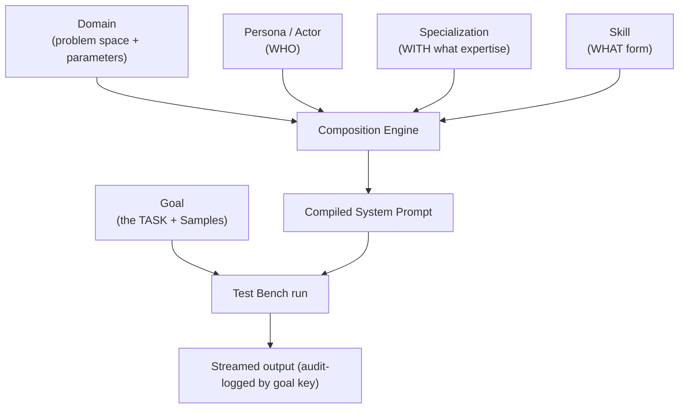
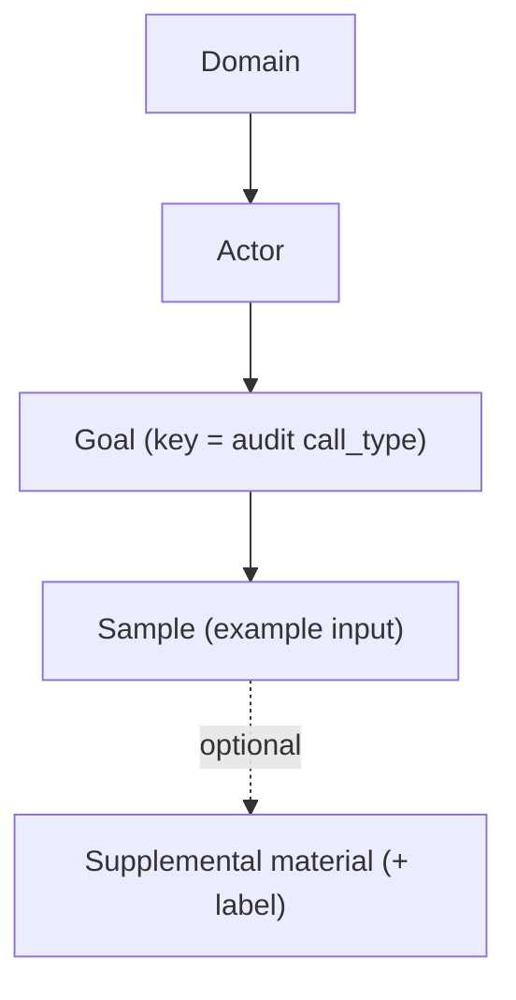

# ActorFactory — Domain × Persona × Specialization × Skill, driven by Goals

**Updated:** October 2026

> Heritage note: this composition model originated in StoryForge AI. ActorFactory
> is a sibling implementation that stores its building blocks as first-class
> entities in SQLite (not YAML templates) and adds a **Goal** dimension — the
> defined task an actor is asked to perform, which carries its own **Samples**.

---

## Overview

ActorFactory composes every LLM call from independent, combinable building blocks, then runs that composition against a concrete task selected as a **Goal**:

| Dimension | Purpose | Seeded Count |
|-----------|---------|:-----:|
| **Domains** | The problem space + parameters | 6 |
| **Personas (Actors)** | WHO the LLM is (professional identity) | 6 |
| **Specializations** | WITH what platform/vendor expertise | 10 |
| **Skills** | WHAT artifact/output form it produces | 8 |
| **Goals** | The TASK the actor performs (+ Samples) | 12 |

A composition is one Persona + zero-or-more Specializations + one Skill, compiled into a system-prompt preamble. A **Goal** selects the specific task (and provides sample inputs) that the composition is run against.



---

## Domains

Each domain frames the problem space and supplies parameters injected into the task prompt.

| Domain | Focus |
|--------|-------|
| Software Engineering | System decomposition, APIs, testing, resilience |
| Infrastructure & Ops | Reliability, deployment, monitoring, DR, cost |
| Product & Business Analyst | Value streams, process flows, stakeholder alignment |
| InfoSec & Security | Threat modeling, IAM, encryption, compliance |
| K-12 Education | Rubric grading, diagnostic feedback, learning gaps |
| Enterprise Architecture | Integration patterns, governance, portfolio, roadmaps |

---

## Personas (Actors)

Each actor maps to a domain and provides core concerns, vocabulary, thinking patterns, and quality criteria.

| Actor | Title | Domain |
|-------|-------|--------|
| Software Architect | Software Architect / Lead Engineer | Software Engineering |
| Site Reliability Engineer | SRE / Cloud Architect | Infrastructure & Ops |
| Product Owner | Product Owner / Business Analyst | Product & Business Analyst |
| Security Architect | Security Architect / Lead Security Engineer | InfoSec & Security |
| Teaching Assistant | Teaching Assistant / Educational Evaluator | K-12 Education |
| Enterprise Architect | Enterprise Architect / Chief Architect | Enterprise Architecture |

---

## Skills

Skills define output format, validation level, quality patterns, and anti-patterns.

| Skill | Output Format | Validation |
|-------|---------------|:----------:|
| Mermaid Diagram Building | ```mermaid code block | Machine (parser) |
| User Story Writing | INVEST stories + acceptance criteria | Structural |
| API Contract Design | OpenAPI 3.0 / event schema | Machine |
| Rubric-Based Assessment & Grading | Structured grade report | Structural |
| Formative Learning Gap Analysis | Misconception + intervention report | Structural |
| Enterprise Application Integration | Integration design + diagram | Structural |
| Architecture Decision Records | ADR (context/decision/consequences) | Structural |
| Technology Roadmap Planning | Phased roadmap with gates | Structural |

---

## Specializations

Platform/vendor/methodology expertise that narrows the model from generic to specific.

| Specialization | Example references |
|----------------|--------------------|
| Amazon Web Services (AWS) | Lambda, ECS/Fargate, DynamoDB, SQS/SNS, EventBridge |
| Kubernetes & Cloud Native | Deployments, Ingress, Istio, Helm, HPA |
| Agile & Process Automation | INVEST, Fibonacci, SLA escalation, approval routing |
| STEM & Quantitative Assessments | Step-by-step derivation checking, partial credit |
| Humanities & Subjective Writing | Thesis/evidence evaluation, rubric tier matching |
| SAP ERP & S/4HANA | S/4HANA, ABAP, Fiori, BTP, IDoc, CDS views |
| Salesforce Platform | Apex, LWC, Flow, Platform Events, governor limits |
| MuleSoft & API-Led Connectivity | Anypoint, DataWeave, System/Process/Experience APIs |
| ServiceNow Platform | ITSM, CMDB, Flow Designer, IntegrationHub |
| Oracle ERP Cloud & Fusion | Fusion, OIC, FBDI, OTBI, VBCS |

---

## Goals (+ Samples) — the task dimension

A **Goal** is a defined task an actor is asked to achieve. It is the unit of **tracking and tuning**: a goal's `key` becomes the audit-log `call_type`, so every run for a goal is grouped, and a prompt can be tuned for one goal without affecting another.

A goal is scoped to a **domain** and the **actor(s)** it is designed for. Each goal owns a set of **Samples** — interchangeable example inputs that all exercise the same goal. A sample may also carry generic **supplemental reference material** (a rubric, coding standard, reference spec) with a label.



### Seeded goals (2 per domain, 3 samples each)

| Domain | Goals (`key`) |
|--------|----------------|
| Software Engineering | `build_mermaid_diagram`, `api_design` |
| Infrastructure & Ops | `design_infrastructure`, `write_runbook` |
| Product & Business Analyst | `generate_stories`, `process_analysis` |
| InfoSec & Security | `threat_modeling`, `security_review` |
| K-12 Education | `evaluate_student_rubric`, `learning_gap_analysis` |
| Enterprise Architecture | `integration_design`, `technology_roadmap` |

> Example: `build_mermaid_diagram` is one goal with several samples
> ("E-commerce checkout flow", "Real-time notification service", "CI/CD pipeline").
> The sample varies; the goal key logged to the audit trail stays the same, so
> every diagram run is comparable and tunable as a group.

---

## How it comes together (runtime)

1. The user picks a Domain → Actor, and the matching Goal(s) become available.
2. A Goal is selected; its `key` becomes the audit `call_type` and its Samples populate the sample-input dropdown.
3. A sample fills the raw input and any generic supplemental material.
4. Persona + Specialization + Skill compile to a system-prompt preamble server-side.
5. The composition runs against the input; output streams back and is audit-logged under the goal key.

---

## File / API locations (ActorFactory)

| Component | Path / Endpoint |
|-----------|-----------------|
| Entity models (Domain/Actor/Skill/Specialization/Goal/Sample) | `src/actor_factory/models/core.py` |
| Seed data (all building blocks + 12 goals) | `src/actor_factory/storage/seed.py` |
| Composition compile | `DomainActorProfile.compile_actor_system_prompt` (core.py) |
| Catalog CRUD + Goals API | `src/actor_factory/api/routes.py` (`/domains`, `/actors`, `/skills`, `/specializations`, `/goals`) |
| Goal scoping | `GET /api/v1/goals?domain_id=&actor_id=` |
| Run endpoint | `POST /api/v1/orchestrate` (audit `call_type` = goal key) |
| Audit trail | Audit Log tab / `src/actor_factory/llm/audit_logger.py` |
| UI | Composer (design the prompt), Test Bench (run against a goal's sample) |
