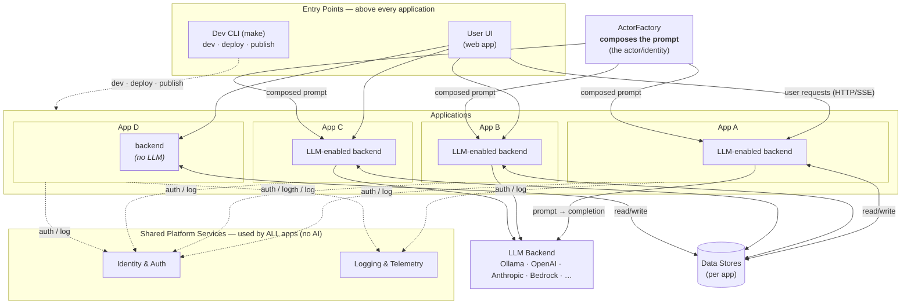
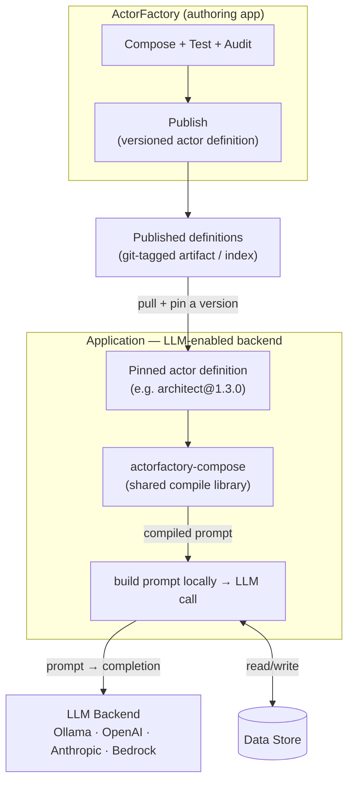

# Consumption Strategy — How Apps Use ActorFactory

[← Back to Architecture Index](./README.md)

ActorFactory exists to **replace static, hard-coded prompt engineering** with composed,
versioned, governable actors. The consumer is the **LLM-enabled backend of an
application** — the code that makes an LLM call and needs a prompt for it. So the question
is: how does that backend actually *use* an ActorFactory actor to produce the prompt for one
of its LLM calls? There are two models, and they are complementary, not competing:

- **Model A — Runtime composition via a hosted service.** The app backend calls a hosted
  ActorFactory service to compile prompts on demand.
- **Model B — Published versioned actor definitions + a shared compile library.** The app
  backend pulls a versioned actor definition and compiles prompts locally, in-process.

Model B ships with zero extra infrastructure; Model A adds central, live governance once you
choose to host ActorFactory as a service. A deployment can use either or both. The rest of
this doc explains each and compares them.

---

## Background: what "compiling a prompt" means here

An actor is a composition — **Persona × Specialization(s) × Skill** — scoped to a
Domain, exercised against a Goal/Sample. Producing a prompt from that selection is a
**pure, deterministic transform** with no I/O:

1. Flatten each rich entity (Actor, Skill, Specialization) into a capability
   instruction (`actor_to_capability`, `skill_to_capability`,
   `specialization_to_capability` in `models/core.py`).
2. Assemble a `DomainActorProfile` and call `compile_actor_system_prompt()` → the
   **system prompt**.
3. `ContextualAssembler.compile_user_prompt(domain_context, raw_input, supplemental)`
   → the **user prompt** (`orchestration/assembler.py`).

Because this logic touches no database, no network, and no LLM provider, it can run
*either* inside a hosted service (Model A) *or* inside the consuming app (Model B). That
is the whole reason both models are possible from one codebase.

> **Precedent.** `mermaid-repair` is Model B in miniature: one versioned library, pinned by
> each app, running in-process — the backend's `POST /mermaid/repair` endpoint holds no
> logic, it just calls the library. Publishing actors follows the same shape, one level up.

---

## Where ActorFactory sits (and where it does not)

ActorFactory is consumed specifically by the **LLM-enabled backend of an application**: that
backend uses ActorFactory's composed output to *build the prompt*, then sends it to an **LLM
backend** (the model) and reads/writes its own **data store** — using whatever shared
platform services (auth, logging) it already uses, exactly like any other service, AI or not.

Above each application typically sit two entry points, present whether or not the app is
LLM-enabled: a **user UI** (the app end users interact with) and a **dev CLI** (e.g. `make`)
that developers use for local dev, deployment, and — for ActorFactory — publication of actor
definitions. The UI is the runtime, human-facing door; the CLI is the build/operate door.

**App D** is the contrast case: a perfectly normal application that is **not** LLM-enabled.
It uses auth, logging, and a data store like everyone else, but it touches neither
ActorFactory nor the LLM backend. AI is one kind of app backend, not a requirement.

Two things the diagram makes explicit:

- **ActorFactory feeds the app backends, not the platform.** Only **LLM-enabled backends**
  consume ActorFactory's composed prompt. The backend still owns the LLM call to the **LLM
  backend** and its reads/writes to its **data store**.
- **Auth and Logging are not ActorFactory's concern.** They are ordinary shared services the
  app uses regardless of AI.

### Model A — runtime composition

In **Model A**, the app backend gets its composed prompt by **calling a hosted ActorFactory
service at runtime** — `actor id + goal + input → composed prompt`. The backend then does its
own LLM call and persistence as above.

**Strengths**
- Single source of truth at runtime — a prompt-engineering fix reaches every app the
  instant it ships, with no app redeploy.
- Central governance on the hot path: model policy, audit logging, rate limiting enforced in
  one place.
- Apps stay thin; no need to carry actor definitions or compile logic.

**Costs / risks**
- ActorFactory becomes a **runtime dependency on every request**. Its latency and
  availability become every app's latency and availability. If it's down, prompt
  generation is down everywhere.
- Couples otherwise-independent apps through a shared live service (shared blast radius).
- **Requires hosting.** You must operate ActorFactory as an available service for app
  backends to depend on at request time.

## Model B — Published versioned actor definitions + shared compile library

ActorFactory (the authoring app) remains the authoring, cataloging, testing (Test Bench),
auditing, and **publishing** surface. Publishing emits a **versioned, portable actor
definition** (a self-contained JSON bundle — the composition with its referenced entities
*embedded*, not ID-only). The app's **LLM-enabled backend** pulls and pins a definition and
compiles the prompt **locally**, in-process, via a small shared library — no runtime call to
ActorFactory. It then does its own LLM call and persistence exactly as in the diagram above.

**Strengths**
- **No runtime coupling.** The consuming app keeps working if ActorFactory is offline —
  it holds the pinned definition and the library locally.
- **Deliberate upgrades.** Each app pins a version (`architect@1.3.0`) and bumps when
  ready — exactly how you pin `mermaid-repair`.
- Fast, local, no network on the compile path.
- Shippable **now** — no hosted service required.

**Costs / risks**
- **Version drift:** an app can lag on an old actor version; a prompt fix only reaches
  it when it bumps its pin. (This is a feature for stability, a cost for propagation.)
- Two things to version: the **actor definition schema** and the **compile library**.
- Compile logic is duplicated into each app's process (acceptable — it's small and
  pure, same as mermaid-repair).

---

## Compare & contrast

| Dimension | Model A (hosted, runtime) | Model B (published defs + library) |
|-----------|---------------------------|-------------------------------------|
| Coupling | Runtime dependency per request | Build/deploy-time only; decoupled at runtime |
| Availability blast radius | Shared — ActorFactory down = all apps affected | Isolated — no runtime effect if it's down |
| Prompt-fix propagation | Instant, no redeploy | On version bump (deliberate) |
| Governance on hot path | Central & enforced live | Enforced at authoring/publish; apps trusted to pin |
| Latency | +1 network hop (or full remote call) | In-process, no hop |
| Infra required | A hosted ActorFactory service | None beyond an artifact/index |
| Version control by app | Hard (everyone on latest) | Easy (pin + bump) |
| Availability today | Needs hosting | ✅ Shippable now |
| Best for | Central control, thin apps | Decoupled apps, offline resilience, incremental rollout |

They are complementary. B gives **decoupling and version control**; A gives
**centralization and instant reach**. Many deployments start with B and add A later.

---

## Now & then strategy

### Now — Model B
1. Define the **actor definition schema**: a versioned, portable JSON bundle embedding
   the resolved Persona + Specializations + Skill (+ optional Domain and Goal/Samples),
   with a `schema_version` and a stable `actor_key` + `version`.
2. Extract the pure compile pipeline from `models/core.py` + `orchestration/assembler.py`
   into a standalone **`actorfactory-compose`** library. The ActorFactory backend then
   imports it (its `/compose/preview` and `/orchestrate` delegate to the library — the
   `mermaid-repair` pattern: the app holds no compile logic of its own).
3. Add a **publish** action in ActorFactory that serializes a composition to a versioned
   definition and writes it to a distribution point (start with git-tagged artifacts —
   zero new infra, like `mermaid-repair`).
4. Downstream apps add two pinned dependencies — the library and the actor definition(s)
   — and compile locally.

### Then — Model A
5. Host ActorFactory's compose/orchestrate behind a service for runtime composition.
   Because the compile logic is **the same library**, the hosted service and the local
   library stay byte-for-byte consistent — A is literally B's library behind an HTTP
   boundary.
6. Apps choose per-use-case: call the service (A) when they want instant central updates
   and live governance, or pin a definition (B) when they need offline resilience and
   deliberate version control. Both remain supported.

### Discovery (shared by both)
A thin **read-only search/browse API** on ActorFactory (list/search the catalog, fetch a
definition to pin) is useful under either model and is *not* on the prompt-generation hot
path. It can land alongside B: discovery over HTTP, compilation in-process.

---

## Related

- [UML Prompt Model](./uml-prompt-model.md) — the conceptual model: a prompt as an identity (Actor), a Goal as a use case.
- [Architecture Overview](./overview.md) — the composition matrix and compile path.
- [AI Strategy & Blueprint](./ai-engineering/ai-strategy.md) — the multi-tier AI application architecture.
