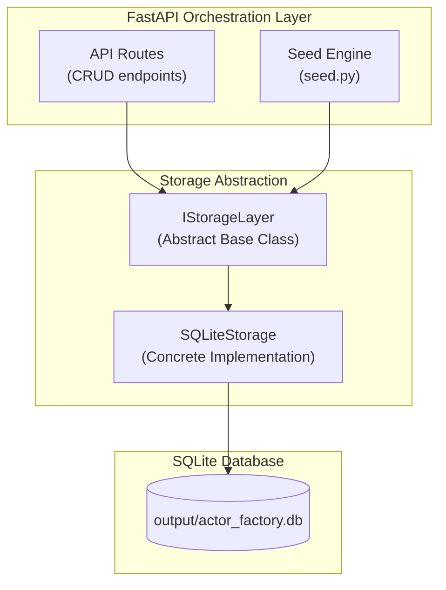
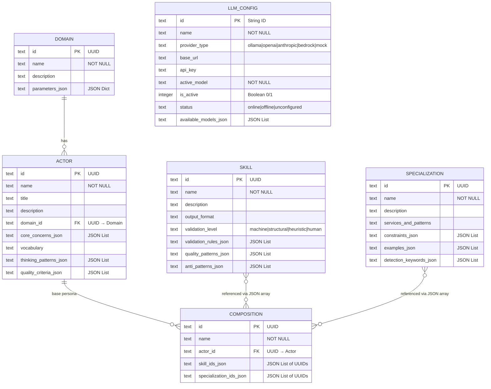
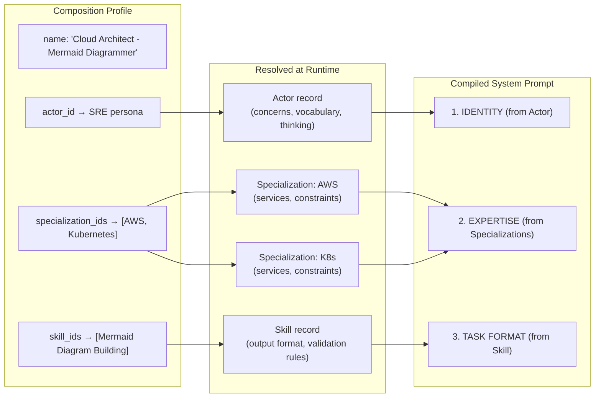

# ActorFactory Storage Layer & Data Model

This document describes the persistent storage architecture, entity-relationship model, and operational patterns of the ActorFactory database.

---

## Storage Architecture

ActorFactory uses a single-file **SQLite** database (`output/actor_factory.db`) with a Python abstraction layer:

### Key Design Decisions

| Decision | Rationale |
|----------|-----------|
| SQLite (single file) | Zero-config local development, portable, embeddable |
| No FK constraints at DB level | Simplifies INSERT OR REPLACE upsert pattern |
| Many-to-many via JSON arrays | Avoids join tables, simplifies CRUD for small catalogs |
| UUIDs stored as TEXT | SQLite has no native UUID type; string representation is portable |
| `INSERT OR REPLACE` for all saves | Makes every save idempotent (upsert semantics) |
| Abstract interface (`IStorageLayer`) | Allows future swap to PostgreSQL or other backends |

---

## Entity-Relationship Diagram

---

## Table Definitions

### `domains`

Defines high-level problem boundaries and operational context parameters.

| Column | Type | Constraints | Description |
|--------|------|-------------|-------------|
| `id` | TEXT | PRIMARY KEY | UUID as string |
| `name` | TEXT | NOT NULL | Domain name (e.g., "Software Engineering") |
| `description` | TEXT | nullable | Purpose and scope |
| `parameters_json` | TEXT | NOT NULL | JSON-serialized `Dict[str, Any]` of default context parameters |

### `actors`

Defines professional expert personas with cognitive approach and domain vocabulary.

| Column | Type | Constraints | Description |
|--------|------|-------------|-------------|
| `id` | TEXT | PRIMARY KEY | UUID as string |
| `name` | TEXT | NOT NULL | Persona name (e.g., "Enterprise Architect") |
| `title` | TEXT | nullable | Display title (e.g., "Enterprise Architect / Chief Architect") |
| `description` | TEXT | nullable | Role summary |
| `domain_id` | TEXT | nullable | Logical FK to `domains.id` |
| `core_concerns_json` | TEXT | NOT NULL | JSON `List[str]` of professional priorities |
| `vocabulary` | TEXT | nullable | Comma-separated domain terms |
| `thinking_patterns_json` | TEXT | NOT NULL | JSON `List[str]` of reasoning approaches |
| `quality_criteria_json` | TEXT | NOT NULL | JSON `List[str]` of output quality checks |

### `skills`

Defines executable capabilities with output format constraints and validation rules.

| Column | Type | Constraints | Description |
|--------|------|-------------|-------------|
| `id` | TEXT | PRIMARY KEY | UUID as string |
| `name` | TEXT | NOT NULL | Skill name (e.g., "Mermaid Diagram Building") |
| `description` | TEXT | nullable | What this skill produces |
| `output_format` | TEXT | nullable | Expected output structure |
| `validation_level` | TEXT | NOT NULL | One of: `machine`, `structural`, `heuristic`, `human` |
| `validation_rules_json` | TEXT | NOT NULL | JSON `List[str]` of checkable constraints |
| `quality_patterns_json` | TEXT | NOT NULL | JSON `List[str]` of positive quality indicators |
| `anti_patterns_json` | TEXT | NOT NULL | JSON `List[str]` of negative patterns to avoid |

### `specializations`

Defines platform, vendor, or subject-matter expertise with detection keywords.

| Column | Type | Constraints | Description |
|--------|------|-------------|-------------|
| `id` | TEXT | PRIMARY KEY | UUID as string |
| `name` | TEXT | NOT NULL | Specialization name (e.g., "SAP ERP & S/4HANA") |
| `description` | TEXT | nullable | Expertise summary |
| `services_and_patterns` | TEXT | nullable | Key services and patterns (plain text) |
| `constraints_json` | TEXT | NOT NULL | JSON `List[str]` of platform-specific rules |
| `examples_json` | TEXT | NOT NULL | JSON `List[str]` of correct usage examples |
| `detection_keywords_json` | TEXT | NOT NULL | JSON `List[str]` of auto-detection triggers |

### `compositions`

Named profiles linking an Actor to Skills and Specializations for prompt assembly.

| Column | Type | Constraints | Description |
|--------|------|-------------|-------------|
| `id` | TEXT | PRIMARY KEY | UUID as string |
| `name` | TEXT | NOT NULL | Profile name (e.g., "Cloud Architect - Mermaid Diagrammer") |
| `actor_id` | TEXT | NOT NULL | Logical FK to `actors.id` (the base persona) |
| `skill_ids_json` | TEXT | NOT NULL | JSON array of `skills.id` UUIDs |
| `specialization_ids_json` | TEXT | NOT NULL | JSON array of `specializations.id` UUIDs |

### `llm_configs`

LLM provider connection configurations and runtime status.

| Column | Type | Constraints | Description |
|--------|------|-------------|-------------|
| `id` | TEXT | PRIMARY KEY | String identifier (e.g., "ollama_local") |
| `name` | TEXT | NOT NULL | Display name |
| `provider_type` | TEXT | NOT NULL | One of: `ollama`, `openai`, `anthropic`, `bedrock`, `mock` |
| `base_url` | TEXT | nullable | Provider endpoint URL |
| `api_key` | TEXT | nullable | Authentication key (nullable for local providers) |
| `active_model` | TEXT | NOT NULL | Currently selected model for this provider |
| `is_active` | INTEGER | NOT NULL | Boolean (0/1). Only one config active at a time |
| `status` | TEXT | NOT NULL | One of: `online`, `offline`, `unconfigured` |
| `available_models_json` | TEXT | NOT NULL | JSON `List[str]` of discovered/configured models |

---

## Relationship Details

### Domain → Actor (One-to-Many, optional)

An Actor optionally belongs to one Domain. A Domain can have many Actors. The relationship is logical — `actors.domain_id` references `domains.id` but no FK constraint is enforced at the database level.

### Actor → Composition (One-to-Many, required)

Each Composition must reference exactly one Actor as its base persona. An Actor can be used in multiple Compositions.

### Skill ↔ Composition (Many-to-Many via JSON)

Compositions store skill references as a JSON array of UUID strings in `skill_ids_json`. This avoids a join table while supporting multiple skills per composition and skill reuse across compositions.

### Specialization ↔ Composition (Many-to-Many via JSON)

Same pattern as Skills — `specialization_ids_json` holds a JSON array of UUID strings.

---

## Composition Assembly Flow

---

## CRUD Operations

All storage operations are exposed via the `IStorageLayer` interface:

| Operation | Method | SQL Pattern |
|-----------|--------|-------------|
| Create/Update | `save_domain()`, `save_actor()`, etc. | `INSERT OR REPLACE INTO ...` |
| Read (list) | `list_domains()`, `list_actors()`, etc. | `SELECT * FROM ... ORDER BY name` |
| Read (single) | `get_llm_config(id)` | `SELECT * FROM ... WHERE id = ?` |
| Delete | `delete_domain(id)`, `delete_actor(id)`, etc. | `DELETE FROM ... WHERE id = ?` |

### Upsert Semantics

All save operations use `INSERT OR REPLACE`, meaning:
- If the primary key doesn't exist → INSERT (create)
- If the primary key already exists → REPLACE (full row update)

This makes the seed engine idempotent — re-running seeds with the same UUIDs overwrites cleanly without duplicate key errors.

---

## Seed Engine Integration

The seed engine (`src/actor_factory/storage/seed.py`) populates the database with canonical baseline data:

1. **On first boot** (`force=False`): Seeds default data only if `domains` table is empty.
2. **On factory reset** (`force=True`): Purges all entity tables atomically, then re-inserts canonical defaults.
3. **Name-based UUID preservation**: Looks up existing entities by name to reuse their UUIDs, preventing duplicate creation and preserving composition references.

---

## File Locations

| Component | Path |
|-----------|------|
| Storage interface | `src/actor_factory/storage/base.py` |
| SQLite implementation | `src/actor_factory/storage/sqlite.py` |
| Data models (Pydantic) | `src/actor_factory/models/core.py` |
| Seed engine | `src/actor_factory/storage/seed.py` |
| Database file | `output/actor_factory.db` |
| API routes (CRUD) | `src/actor_factory/api/routes.py` |

---

## Legacy Tables

The schema also contains two legacy tables from an earlier iteration:

| Table | Purpose | Status |
|-------|---------|--------|
| `capabilities` | Flat ingredient model (Persona/Specialization/Skill/Validator) | Superseded by rich entity tables |
| `profiles` | Flat composition linking capabilities | Superseded by `compositions` table |

Converter functions in `models/core.py` (`actor_to_capability`, `skill_to_capability`, `specialization_to_capability`) bridge the rich models back to the legacy format for prompt compilation compatibility.
