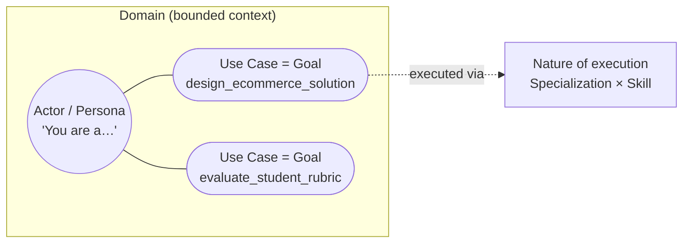

# The UML Prompt Model

[← Back to Architecture Index](./README.md)

> **Audience: technical architecture.** This document gives ActorFactory a conceptual
> spine in a language architects already speak — UML. It explains *why* ActorFactory is
> modeled the way it is, and how a prompt maps onto familiar modeling constructs.

## The core idea: a prompt is an identity

A system prompt is, at bottom, an **identity an LLM is asked to assume** — it literally
begins *"You are a professional {…}"*. Once you see a prompt as *identity + the behavior
expected of that identity in a context*, it maps cleanly onto UML. We did not invent a new
vocabulary; we borrowed one architects already use for modeling identity and behavior.

## The mapping

| ActorFactory concept | UML concept | What it is |
|----------------------|-------------|------------|
| **Domain** | **Domain / bounded context** (system boundary) | The operational context the work happens in (K-12 Education, Software Engineering, InfoSec). Supplies parameters. |
| **Actor (Persona)** | **Actor** (a role/identity) | The identity the LLM assumes — *"You are a Software Architect."* Carries concerns, vocabulary, thinking patterns, quality criteria. |
| **Goal** | **Use Case** | What the actor is asked to achieve (`design_ecommerce_solution`, `evaluate_student_rubric`). **A Goal is the unit of an LLM-call-enabled API call.** |
| **Specialization × Skill** | **the nature of use-case execution** | *How* the use case is carried out — the qualified, specialized manner of execution (platform/subject expertise × the output contract + validation rules). |

Read as one sentence, a composed prompt is a UML statement:

> *This **Actor**, within this **Domain**, executing this **Use Case** (Goal), with this
> **specialized manner of execution** (Specialization × Skill).*

The "You are a professional {actor}" line is the Actor assuming its role; everything after
qualifies the use-case execution.

## Why Goal = Use Case = API call matters

This is the load-bearing equivalence. For an **LLM-call-enabled API**, each distinct call
*is* a Goal, which *is* a use case. That single identity does a lot of work:

- **It names the call** in the audit log (`call_type`), so every invocation of that use
  case is grouped and comparable (the Goal becomes the logging/evaluation key).
- **It is the unit of tuning.** A use case that underperforms is improved by re-composing
  its actor in ActorFactory — not by editing a string somewhere in app code.
- **It is the unit of versioning.** A published actor definition is pinned per use case.

So the UML model is not decoration — it is the same key (the Goal) that threads
composition, logging, evaluation, and tuning together.

## A precise note on "Specialization" (for architects)

In textbook UML, *specialization* means **generalization/inheritance** — a specialized
Actor *is-a* more general Actor. ActorFactory uses "Specialization" in a related but
distinct sense: a **platform/subject qualifier on how a use case is executed** (e.g. an
`AWS` specialization on a `Software Architect` actor, or a `STEM & Quantitative` spec on an
`Assessment Marker`). It qualifies behavior; it is not strictly an inheritance hierarchy.

We keep the ActorFactory term because it reads naturally to practitioners, and we reconcile
it to UML here explicitly:

- The **Actor** is the role/identity (closest to UML Actor).
- A **Specialization** narrows the *manner of execution* of that actor's use cases — think
  of it as a stereotype/qualifier on the execution, not a subclass of the Actor. (If one
  ever wants true generalization — a `Senior Software Architect` that *is-a* `Software
  Architect` and inherits its concerns — that would be modeled as Actor generalization,
  which is a separate, future concern.)
- A **Skill** is the executable capability + output contract (the operation's
  post-condition: output format, validation level, quality/anti-patterns).

Calling this out keeps the model defensible: we are using UML as an *inspiration and a
shared language*, mapping faithfully where the concepts align (Actor, Use Case, Domain)
and flagging the one place our term carries a narrower, execution-qualifier meaning.

## How this shows up in the code

The mapping is literal in the backend compile path:

- `Actor` / `Persona` → the `"Act as a professional {actor_name}."` + identity block
  (`compile_actor_system_prompt`).
- `Specialization` → the `"YOUR EXPERTISE & CONSTRAINTS:"` block.
- `Skill` → the `"CURRENT TASK FORMAT & QUALITY CRITERIA:"` block.
- `Domain` → the `"DOMAIN PARAMETERS:"` block in the user prompt.
- `Goal` → the `call_type` recorded for the call, and the thing a Sample exercises.

(See [Architecture Overview](./overview.md) for the compile pipeline, and
[Consumption Strategy](./consumption-strategy.md) for how the compiled result reaches apps.)

## Related

- [Consumption Strategy](./consumption-strategy.md) — how apps consume composed actors (Models A and B).
- [Architecture Overview](./overview.md) — the composition matrix and compile path.
- [Persona × Skill Composition](./ai-engineering/persona-skill-composition.md) — building validatable expertise.
