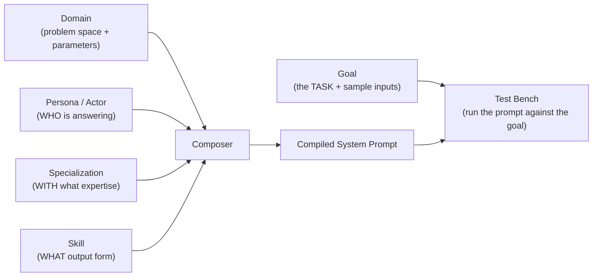

# Welcome to ActorFactory

ActorFactory is a **prompt-engineering workbench**. Instead of writing a system prompt from scratch every time, you *compose* one from reusable building blocks, then run it against a concrete **goal** and compare models.

## The core idea

A strong system prompt is assembled from reusable building blocks, then pointed at a specific task to perform:

- **Domain** — the problem space and its parameters (e.g. Software Engineering, microservices on AWS).
- **Persona (Actor)** — *who* is answering (e.g. Software Architect).
- **Specialization** — *with what expertise* (e.g. Amazon Web Services).
- **Skill** — *what form* the output takes (e.g. a Mermaid diagram, a graded rubric).
- **Goal** — *what task* the actor is asked to do (e.g. "Build a Mermaid Diagram", "Grade a Student Submission").

Combine a Persona × Specialization × Skill and ActorFactory compiles them into a single system prompt. You then choose a **Goal** — the actual task — and run the prompt against it.

## What a Goal is (and why it matters)

A **Goal** is a defined task an actor performs, scoped to the domains and actors it fits. It's the most important new idea in ActorFactory because it's the unit of **tracking and tuning**:

- Each goal has a stable key (e.g. `build_mermaid_diagram`) that is written to the **audit log** with every run. So you can see every run of a goal grouped together, compare outputs across models or prompt edits, and tune the prompt for *one* goal without disturbing others.
- Each goal carries **Samples** — ready-made example inputs that all exercise that same goal. One goal, many samples: "E-commerce checkout flow", "Real-time notification service", and "CI/CD pipeline" are all samples of `build_mermaid_diagram`.
- A sample may include **supplemental reference material** (a grading rubric, a coding standard, a reference spec) — generic, not tied to any one task type.

So the hierarchy is: **Domain / Actor → Goals → Samples.** The goal is the task; the sample is one way to ask it.

## Where things happen

- **Build Blocks** (Domains, Actors, Skills, Specializations) — author the reusable pieces.
- **Composer** — pick pieces, see the compiled system prompt, and save it as a reusable Composition.
- **Test Bench** — pick a goal, load one of its samples (or write your own), and run the composition against it; watch the output stream back.

## A 60-second first run

1. Go to **Test Bench**.
2. Pick a **Domain** and **Actor** (e.g. Software Engineering → Software Architect). The goals for that actor appear.
3. Pick a **Goal** (e.g. "Build a Mermaid Diagram"). Its first sample input loads automatically.
4. (Optional) Use **Load sample input…** to try a different sample of the same goal.
5. Make sure a model is selected, then **Run Composition Engine**.
6. Watch the output stream; diagrams render once the run completes. The run is logged under the goal's key so you can find and compare it later.

That's the whole loop: compose instructions, pick a goal, feed it a task, read the result.
